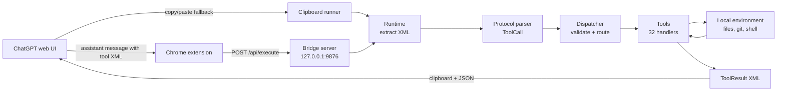

# ChatGPT Agent

A local coding-agent runtime that lets ChatGPT interact with your
development environment through structured tools. ChatGPT emits
`<tool_call>` / `<tool_batch>` XML in its replies; a local bridge captures
that XML and a local tool runtime executes it — reading, editing, and
analyzing code, running commands and tests, and returning structured
results to paste back into the chat.

One project, two components:

- **`chatgpt-bridge/`** — Chrome extension + local HTTP server + clipboard
  runners. Captures tool XML from ChatGPT and delivers results.
- **`chatgpt-tools/`** — the tool runtime: protocol parsing, schema
  validation, dispatch, and 32 tool implementations.
- **`AGENT_PROTOCOL.md`** — the wire-protocol contract both sides obey.

No third-party Python dependencies. Standard library only (plus `rg`
for search-based tools and `pytest` for the test tools).

## Architecture



Concretely: the content script polls ChatGPT assistant messages, waits
until a reply stabilizes, and forwards text containing tool XML to the
bridge server. `runtime.py` extracts the XML (`bridge/xml_extractor.py`),
parses it (`chatgpt-tools/protocol/parser.py`), dispatches it
(`dispatcher/dispatcher.py` → `tools/registry.py`), and writes the
`<tool_result>` XML to the clipboard while returning a JSON summary to
the extension. The clipboard runners (`bridge/watcher.py`,
`bridge/main.py`, `chatgpt-tools/clipboard_runner.py`,
`chatgpt-tools/main.py`) provide the same loop without HTTP.

## Capabilities

Only what is actually implemented:

- **Filesystem** — read (with line ranges + SHA-256), list, write, create,
  delete, find-and-replace patching.
- **Optimistic concurrency** — `WRITE_FILE`, `PATCH_FILE`,
  `PATCH_SYMBOL`, `REPLACE_FUNCTION`, `ADD_FUNCTION`, `DELETE_FUNCTION`
  accept `expected_sha` and refuse on stale state (check-then-write, not
  atomic — see Limitations).
- **Code intelligence** — AST-based definition lookup, reference search
  (ripgrep), symbol read/replace/add/delete, call-graph tracing
  (depth-capped at 5), impact analysis, project map.
- **Git** — status, diff, log (limit clamped 1–100), show, blame.
- **Execution** — allowlisted subprocess (`python python3 pytest git uv
  npm pnpm`, 5 s timeout) and PTY-based interactive execution (same
  allowlist, 30 s timeout); `RUN_TEST` / `RUN_TESTS` drive the local
  pytest suite.
- **Patch verification** — parses and compiles the file and infers
  impacted tests by filename. It does **not** run tests, resolve imports,
  or prove safety (see Limitations).
- **Tasks** — `TODO_ADD` / `TODO_LIST` / `TODO_DONE` backed by
  `todos.json`.
- **Protocol** — single calls and sequential `<tool_batch>` batches with
  `id` correlation; schema validation (required/optional/unknown args);
  unknown tools and handler exceptions become `success=false` results —
  dispatch never raises. See `AGENT_PROTOCOL.md`.

## Installation (fresh clone)

Prerequisites: Python 3.9+, `rg` (ripgrep) on `PATH` for the search-based
tools, `pytest` importable for the test tools, Google Chrome for the
extension, macOS for the clipboard runners (`pbpaste`/`pbcopy`).

```bash
git clone <this-repo> && cd chatgpt-agent

# Tool runtime (stdlib only — nothing to install for libraries)
cd chatgpt-tools
python3 -m pytest tests/ -q        # should be all green

# Bridge server (stdlib only)
cd ../chatgpt-bridge
pip install -e .                   # provides the `chatgpt-agent` script
                                   # (needs pip >= 23; otherwise first run
                                   #  `pip install --upgrade pip setuptools`)
chatgpt-agent start                # serves http://127.0.0.1:9876
```

No install is strictly required: `python3 server.py` (or
`python3 cli.py start`) in `chatgpt-bridge/` runs the server from a plain
checkout, and the tool runtime is used in place via `sys.path`.

Extension: `chrome://extensions` → Developer mode → Load unpacked →
select `chatgpt-bridge/chrome-extension`. Details and UI-coupling notes in
`chatgpt-bridge/chrome-extension/README.md`.

## Usage

1. Start the server (`chatgpt-agent start`) and load the extension.
2. In ChatGPT, instruct the model to answer with tool XML (a ready-made
   system prompt ships as `chatgpt-tools/prompt.txt` — its bootstrap rule
   makes the model's first reply exactly
   `<tool_call><tool>HELP</tool></tool_call>`).
3. When the model replies with a tool call, the extension forwards it;
   the result XML lands on your clipboard and a summary appears in the
   on-page panel. Paste the result back to ChatGPT for the next turn.

Manual round-trip without ChatGPT:

```bash
cd chatgpt-tools
cp list_test.xml request.xml && python3 main.py   # writes response.xml
```

Example exchange from the fixtures:

```xml
<tool_call>
    <tool>RUN_COMMAND</tool>
    <command>python --version</command>
</tool_call>
```

```xml
<tool_result>
  <success>true</success>
  <command><![CDATA[python --version]]></command>
  <exit_code><![CDATA[0]]></exit_code>
  <stdout><![CDATA[Python 3.9.x]]></stdout>
  ...
</tool_result>
```

The full message format — single calls, batches, `id` correlation, error
shapes, and how XML is extracted from chat text — is specified in
[`AGENT_PROTOCOL.md`](AGENT_PROTOCOL.md).

## Security model

Read this before running. This project executes code and rewrites files
on your machine by design.

- **Local only.** The server binds `127.0.0.1:9876`. Keep it that way —
  binding `0.0.0.0` or port-forwarding exposes unauthenticated code
  execution.
- **No authentication.** The HTTP API, the clipboard loop, and the tool
  layer accept whatever they are given. CORS is `*`, so any web page open
  in your browser while the server runs can POST tool calls. Treat a
  running server like an open terminal: don't browse untrusted sites with
  it up, don't run it on shared machines, stop it when done.
- **The command allowlist is not a sandbox.** `RUN_COMMAND` /
  `RUN_INTERACTIVE` restrict the executable to
  `python python3 pytest git uv npm pnpm` (parsed with `shlex`, no shell),
  but an allowlisted interpreter runs arbitrary code — `python -c ...`
  can do anything you can. There are no working-directory restrictions,
  no environment scrubbing, and timeouts kill (5 s / 30 s) but don't
  isolate.
- **Filesystem tools are not sandboxed.** They accept absolute paths and
  `..` segments, follow symlinks, auto-create parent directories, and
  the stale-SHA check is opt-in per call and check-then-write (TOCTOU).
  Writes go through a temp-file + atomic rename, but concurrent writes
  from outside the runtime are not locked out.
- **Extension permissions are minimal** (`scripting` + the two ChatGPT
  origins + localhost), but the content script forwards *any* assistant
  message containing tool-looking XML — a prompt-injected reply is
  executed like any other.
- **`VERIFY_PATCH` / "Imports: OK" prove little.** They mean "the file
  parses and compiles", not "imports resolve" (`compile()` cannot raise
  `ImportError`) and not "tests pass" (no tests are run). The verdict
  wording in the tool output says exactly this.
- Logs and result envelopes contain tracebacks with local absolute
  paths; `logs/` and `todos.json` are git-ignored runtime state.

## Limitations (honest list)

- **ChatGPT DOM coupling.** Detection depends on current ChatGPT markup
  (`data-message-*` selectors, English button labels, stable-text
  heuristic). A UI redesign can silently stop it.
- **No streaming.** The extension waits for a reply to stabilize before
  acting; partial tool calls mid-stream are ignored.
- **Local-only, single user.** No auth, no multi-user isolation, no
  remote use case. Not production software; v0.1.0.
- **macOS clipboard.** `pbpaste`/`pbcopy` only; elsewhere the clipboard
  runners exit with a clear error (HTTP bridge works anywhere).
- **`rg` required** for `SEARCH`, `FIND_REFERENCES`, and symbol indexing
  (`find_python_files` falls back to a `pathlib` walk; the rest return an
  error string when `rg` is missing).
- **Stale symbol index.** The `ast_utils` cache has no mtime
  invalidation; only tool-dispatched mutations clear it. External edits
  (your editor, another process) can read stale until the next mutating
  dispatch. Ambiguous (multi-definition) symbols resolve last-file-wins.
- **Stale-file protection is opt-in and racy.** Omit `expected_sha` and
  there is no check; provide it and there is still a check-then-write
  window.
- **Batch Model dependence.** The protocol assumes the model emits
  exactly one valid XML block per turn; sibling blocks outside a batch
  are ignored (only the first valid candidate executes via the bridge).
- **XML parsing is `xml.etree` without hardening** (no entity-expansion
  limits, 10 MB body cap on HTTP only).

## License

MIT — see [LICENSE](LICENSE).
